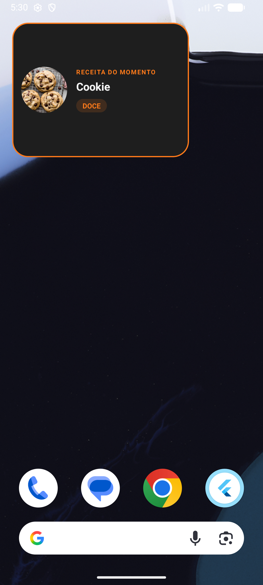

# 📖 Livro de Receitas

Aplicativo Flutter para guardar, descobrir e organizar receitas. Com visual escuro e detalhes em laranja, o app consome uma API REST para listar, cadastrar, editar e excluir receitas, permite buscar por nome ou ingrediente, filtrar por tipo e marcar as receitas favoritas. No Android ele também tem um **Home Screen Widget** que mostra uma receita aleatória direto na tela inicial do celular.

## ✨ Funcionalidades

- **CRUD de receitas**: listar, cadastrar, editar e excluir receitas pela API.
- **Busca** por nome da receita ou por ingrediente.
- **Filtros por tipo**: Todas, Doces, Salgadas e Bebidas.
- **Favoritas**: marque receitas como favoritas (salvas no aparelho com `shared_preferences`) e filtre só por elas.
- **Widget personalizado** (`MeuInfoWidget`): um cartão na tela inicial do app com o total de receitas disponíveis e de favoritas.
- **Home Screen Widget (Android)**: pelo botão **Criar Widget** na barra superior, o app envia as receitas para um widget na tela inicial do celular. O widget mostra nome, foto (recortada em círculo) e tipo de uma receita sorteada e, ao ser tocado, abre o app.
- Splash screen e menu lateral.

## 🌐 API

As receitas vêm da API:

https://receitasapi-b-2025.vercel.app/receitas

## 🛠️ Tecnologias

- [Flutter](https://flutter.dev) / Dart
- [http](https://pub.dev/packages/http): requisições à API
- [shared_preferences](https://pub.dev/packages/shared_preferences): receitas favoritas
- [home_widget](https://pub.dev/packages/home_widget): comunicação com o Home Screen Widget
- [path_provider](https://pub.dev/packages/path_provider): salvar as imagens usadas pelo widget
- Kotlin + `AppWidgetProvider` (lado nativo do widget no Android)

## ▶️ Como rodar

Pré-requisitos: Flutter instalado e um emulador ou celular Android conectado.

```bash
flutter pub get
flutter run
```

### Testando o Home Screen Widget

1. Abra o app e espere as receitas carregarem.
2. Toque no ícone **Criar Widget** na barra superior e confirme a adição do widget na tela inicial.
   - Se o launcher não suportar esse pedido, segure em um espaço vazio da tela inicial → **Widgets** → **Livro de Receitas** e arraste o widget.
3. Toque no widget para abrir o app.

## 📱 Screenshots

| Tela inicial | Detalhes da receita | Cadastro de receita |
| :---: | :---: | :---: |
|  |  |  |

### Home Screen Widget



*Home Screen Widget*
